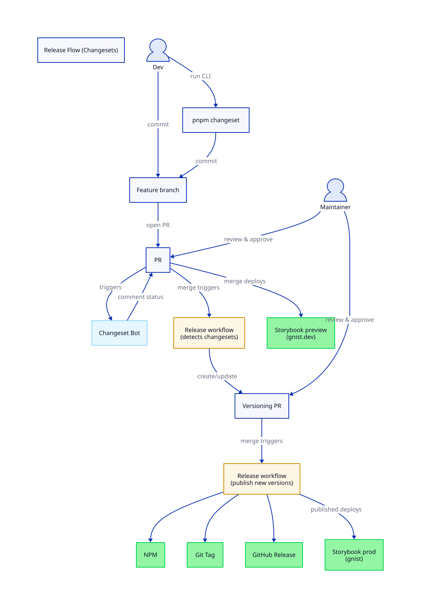

# Release

We currently use [Changesets](https://github.com/changesets/changesets) and [Changeset Release Action](https://github.com/changesets/action) for tracking changes, generating changelogs, and publishing releases. [Changeset bot](https://github.com/apps/changeset-bot) notifies in PR if you forgot to add a changeset.

## Release process

- Create a feature branch and commit your changes. Run `pnpm changeset` in the root of the repo to add a new changeset.

- Merge the PR after checks pass.

- The merge deploys the current `main` branch Storybook to
  [gnist.dev.arbeidstilsynet.no](https://gnist.dev.arbeidstilsynet.no).

- [Changeset Release Action](https://github.com/changesets/action) should notice the changesets (inside `.changeset/`) and generate or update a PR with bumped version and changelog.

- Approve and merge the changesets versioning PR.

- [Changeset Release Action](https://github.com/changesets/action) will now publish the new package version to [NPM](https://www.npmjs.com/org/arbeidstilsynet), add a git tag and create [GitHub releases](https://github.com/Arbeidstilsynet/design/releases).

- After packages are published, Storybook is deployed to
  [gnist.arbeidstilsynet.no](https://gnist.arbeidstilsynet.no), so production
  Storybook tracks the latest published package versions.

- For initial bootstrap or break-glass deploys, run the manual
  `Deploy Storybook prod (manual)` workflow from `main`. The normal production
  Storybook deploy should still happen through package publishing.

- To share an ad hoc Storybook from a feature branch, run the manual
  `Deploy Storybook ad hoc to Nais` workflow from that branch. It deploys a
  separate dev-cluster app to
  [gnist-demo.dev.arbeidstilsynet.no](https://gnist-demo.dev.arbeidstilsynet.no)
  with a 24-hour TTL, and fails if run from `main`.

- Verify that new version is available in [NPM](https://www.npmjs.com/org/arbeidstilsynet) and on [GitHub releases](https://github.com/Arbeidstilsynet/design/releases)

## Storybook deployment configuration

All Storybook deploys use the reusable
[Nais workflow](./.github/workflows/deploy-storybook-nais.yml), which installs
the Nais CLI with `nais/setup` and deploys with `nais apply --wait`. The newly
built container image is supplied through `--set spec.image`.

The shared [application manifest](./.nais/storybook.yml) is merged with a
plain YAML mixin selected by the caller:

- [Development](./.nais/storybook.dev.yml) and
  [production](./.nais/storybook.prod.yml) set the ingress for their Nais
  environment.
- [Demo](./.nais/storybook.demo.yml) overrides the app name and ingress and
  sets the 24-hour TTL. It deploys to the `dev` environment, so its mixin is
  passed explicitly rather than selected by environment name.

Mixins replace the previous Handlebars variables files. Lists are appended
during merging, so environment-specific ingresses belong only in the mixins.
CI validates the merged manifest for each mixin.

